Contributing
============

Before we start, a brief detail on the project contribution flow. 

The project will operate on a fork and pull request basis, where each contributor will work on their own fork (or copy) of the repository and push their local changes there. Once the changes are **stable** and **working** (← important)) and new features or fixes are made, the contributor will make a pull request to merge their changes into the upstream main repository.

tldr:
- before start
  - fork repo
  - clone from your fork
  - add upstream remote
- during dev
  - commit changes and push to fork (usually origin/master)
  - once code is working and no errors, create pull request
- during pull request
  - maintainer will perform a code review and approve or request change on the pull request
  - if changes are requested, continue to commit and push to your fork and the pull request will update
  - once changes looks good, pull request is approved and merged
- after pull request
  - sync fork with upstream

> Make sure to sync the fork with the upstream repository regularly to prevent old history and possible merge conflicts.

## Demo

> The below resources are oriented at using PhpStorm as the IDE.

### Forking repository

Navigate to the upstream repository https://github.com/sirap-bandung/university-library-system and create a fork.

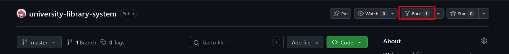

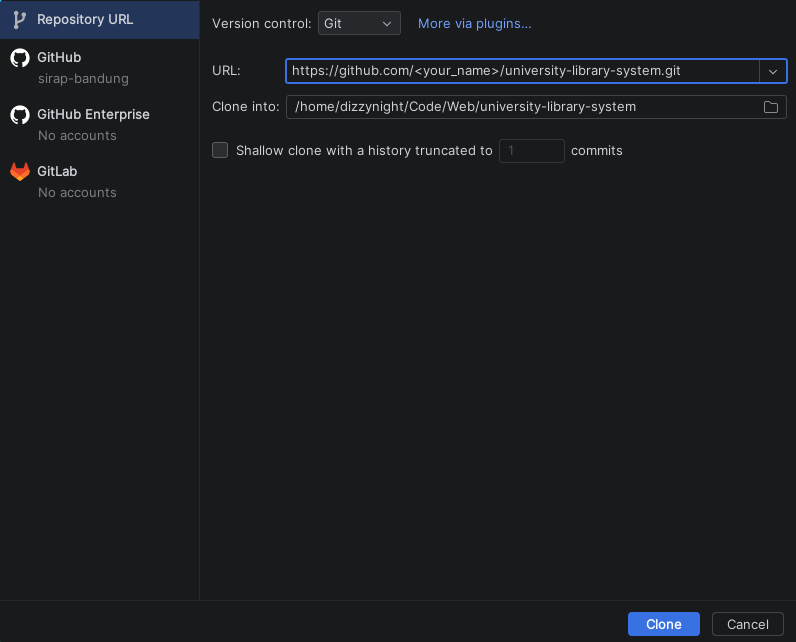

### Cloning

After forking the repository to your account. You can clone it into your device.

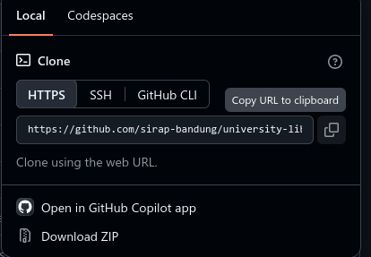

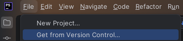

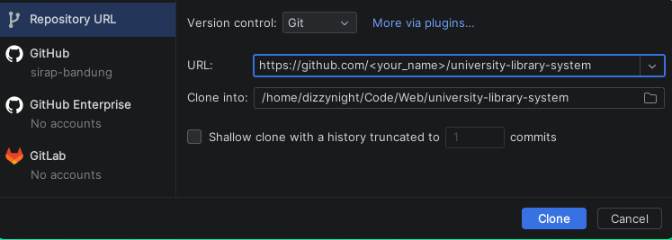

### Adding upstream remote

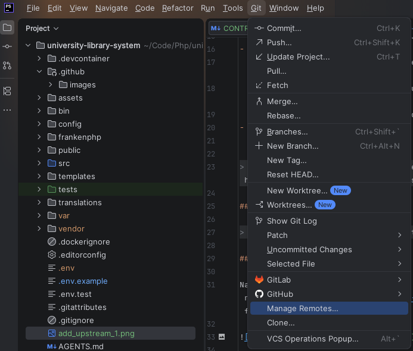

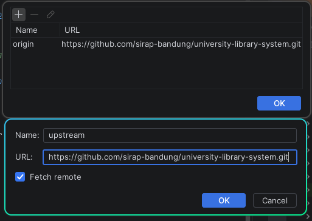

### Opening a pull request

Open the Pull Requests tab in PhpStorm.

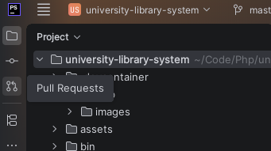

Change repository to the **upstream** repository.

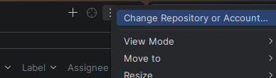

Open a pull request.

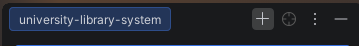

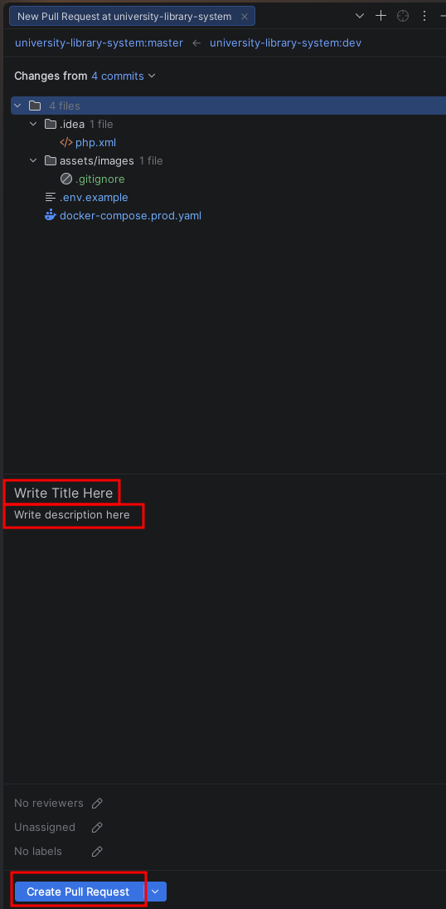
